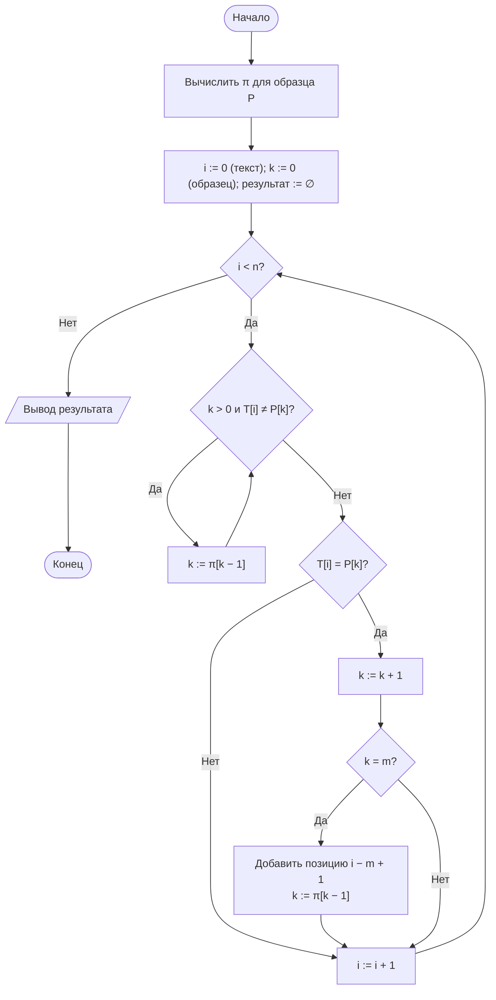

# Лабораторная работа № 11

## Алгоритмы поиска подстроки и вычисления редакционного расстояния

**Дисциплина:** Теория алгоритмов
**Направление подготовки:** 38.03.05 «Бизнес-информатика»
**Курс:** 2
**Объём:** 4 академических часа
**Язык реализации:** Python 3.10+
**Предварительные требования:** ЛР № 7 (динамическое программирование)

---

## 1. Цель и задачи работы

**Цель работы:** изучить алгоритмы обработки текстовых данных — точный поиск подстроки и оценку близости строк — и применить их к задаче сопоставления записей из разных информационных систем.

**Задачи:**

1. Изучить наивный алгоритм поиска подстроки и алгоритм Кнута — Морриса — Пратта.
2. Реализовать вычисление префикс-функции и объяснить её смысл.
3. Реализовать вычисление редакционного расстояния (расстояния Левенштейна) методом динамического программирования.
4. Сравнить алгоритмы поиска по времени на «удобных» и «неудобных» текстах.
5. Решить прикладную задачу сопоставления наименований контрагентов при наличии опечаток.

---

## 2. Теоретическая часть

### 2.1. Задача поиска подстроки

Даны текст $T$ длиной $n$ и образец $P$ длиной $m$ ($m \le n$). Требуется найти все позиции $i$, для которых $T[i..i+m-1] = P$.

Задача возникает при поиске по документам, фильтрации журналов событий, разборе форматов данных и проверке регулярных выражений.

### 2.2. Наивный алгоритм

Образец последовательно прикладывается ко всем позициям текста, и в каждой позиции выполняется посимвольное сравнение.

$$T_{\text{худш}}(n, m) = \Theta((n - m + 1) \cdot m) = \Theta(nm).$$

На случайном тексте среднее число сравнений близко к $\Theta(n)$, поскольку несовпадение обнаруживается на первых символах. Худший случай достигается на текстах с большим числом повторов: например, $T = \underbrace{aa\ldots a}_{n}$ и $P = \underbrace{aa\ldots a}_{m-1}b$. Именно такие данные используются в экспериментальной части.

### 2.3. Алгоритм Кнута — Морриса — Пратта

Идея алгоритма: при несовпадении не возвращать указатель текста назад, а сдвигать образец на величину, вычисленную заранее по самому образцу.

**Префикс-функция.** Для строки $P$ значение $\pi[i]$ равно длине наибольшего собственного префикса подстроки $P[0..i]$, который одновременно является её суффиксом.

Пример для $P = \text{«abcabd»}$:

| $i$ | 0 | 1 | 2 | 3 | 4 | 5 |
|---|---|---|---|---|---|---|
| $P[i]$ | a | b | c | a | b | d |
| $\pi[i]$ | 0 | 0 | 0 | 1 | 2 | 0 |

Смысл: если совпало 5 символов («abcab») и шестой не совпал, то совпадение первых двух символов («ab») уже обеспечено, и сравнение можно продолжить с третьего символа образца. Возврат по тексту не требуется.

**Трудоёмкость:**

$$T(n, m) = \Theta(n + m),$$

причём и вычисление префикс-функции, и сам поиск выполняются за линейное время. Доказательство опирается на то, что величина сдвига никогда не убывает [1, 2].

| Алгоритм | Предобработка | Поиск | Худший случай |
|---|---|---|---|
| Наивный | Нет | — | $\Theta(nm)$ |
| Кнута — Морриса — Пратта | $\Theta(m)$ | $\Theta(n)$ | $\Theta(n + m)$ |
| Рабина — Карпа (хеш-поиск) | $\Theta(m)$ | $\Theta(n)$ в среднем | $\Theta(nm)$ |

### 2.4. Редакционное расстояние

**Расстояние Левенштейна** $d(A, B)$ — минимальное число элементарных операций (вставка, удаление, замена символа), преобразующих строку $A$ в строку $B$.

Рекуррентное соотношение. Пусть $D[i][j]$ — расстояние между префиксами $A[0..i-1]$ и $B[0..j-1]$. Тогда

$$D[i][j] = \min \begin{cases} D[i-1][j] + 1 & \text{(удаление)}, \\ D[i][j-1] + 1 & \text{(вставка)}, \\ D[i-1][j-1] + c_{ij} & \text{(замена)}, \end{cases}$$

где $c_{ij} = 0$ при $A[i-1] = B[j-1]$ и $c_{ij} = 1$ иначе. Граничные условия: $D[i][0] = i$, $D[0][j] = j$.

**Трудоёмкость:** $\Theta(nm)$ по времени и $\Theta(nm)$ по памяти; при хранении двух строк таблицы память сокращается до $\Theta(\min(n, m))$, но тогда становится невозможным восстановление самой последовательности операций.

**Нормированная мера сходства:**

$$\text{sim}(A, B) = 1 - \frac{d(A, B)}{\max(\lvert A \rvert, \lvert B \rvert)} \in [0; 1].$$

### 2.5. Нечёткое сопоставление записей

Типовая задача интеграции данных: две информационные системы содержат наименования одних и тех же контрагентов, записанные по-разному («ООО Ромашка», «Ромашка, ООО», «ООО «РОМАШКА»»). Требуется сопоставить записи.

Порядок обработки:

1. **Нормализация:** приведение к нижнему регистру, удаление знаков препинания и кавычек, удаление организационно-правовых форм (ООО, АО, ПАО), сжатие пробелов.
2. **Точное сопоставление** нормализованных строк (хеш-таблица, ЛР № 5).
3. **Нечёткое сопоставление** оставшихся записей по расстоянию Левенштейна с порогом сходства.

Трудоёмкость прямого сравнения «каждый с каждым» составляет $\Theta(N^2 L^2)$, где $N$ — число записей, $L$ — их средняя длина. Это ограничивает применимость метода и требует предварительной фильтрации кандидатов (блокирование по первой букве, по длине строки).

---

## 3. Порядок выполнения работы

1. Изучить теоретическую часть.
2. Реализовать наивный поиск подстроки и алгоритм КМП с вычислением префикс-функции.
3. Вычислить префикс-функцию для образца из своего варианта **вручную** и сверить с результатом программы.
4. Измерить время обоих алгоритмов на случайном тексте и на «неудобном» тексте с повторами при возрастающей длине текста.
5. Реализовать расстояние Левенштейна и меру сходства.
6. Решить задачу сопоставления записей: выполнить нормализацию, точное и нечёткое сопоставление, вывести найденные пары с оценкой сходства.
7. Выполнить дополнительное задание и оформить отчёт.

---

## 4. Варианты заданий

**Таблица 1. Исходные данные**

| № | Образец для ручного расчёта $\pi$ | Тип текста | Длины текста $n$ | Порог сходства | Доп. |
|---|---|---|---|---|---|
| 0 | abcabd | Случайный и с повторами | 10⁴; 10⁵; 10⁶ | 0,80 | — |
| 1 | aabaaab | Случайный | 10⁴; 5·10⁴; 10⁵ | 0,75 | Л1 |
| 2 | abababc | С повторами | 10⁴; 10⁵; 5·10⁵ | 0,85 | Л2 |
| 3 | abcabcd | Естественный текст | 10⁴; 10⁵ | 0,80 | Л3 |
| 4 | aaabaaa | С повторами | 10⁴; 10⁵; 10⁶ | 0,70 | Л4 |
| 5 | abacaba | Случайный | 10⁵; 5·10⁵; 10⁶ | 0,85 | Л5 |
| 6 | ababaca | Естественный текст | 10⁴; 5·10⁴ | 0,80 | Л6 |
| 7 | aabbaab | С повторами | 10⁴; 10⁵; 10⁶ | 0,75 | Л7 |
| 8 | abcdabc | Случайный | 10⁴; 10⁵; 10⁶ | 0,80 | Л1 |
| 9 | aaaaab | С повторами | 10⁴; 10⁵; 5·10⁵ | 0,90 | Л2 |
| 10 | abcabca | Естественный текст | 10⁴; 10⁵ | 0,75 | Л3 |
| 11 | abbabba | Случайный | 10⁵; 10⁶ | 0,80 | Л4 |
| 12 | acabaca | С повторами | 10⁴; 10⁵; 10⁶ | 0,85 | Л5 |
| 13 | abcaabc | Случайный | 10⁴; 5·10⁴; 10⁵ | 0,80 | Л6 |
| 14 | aabaaba | С повторами | 10⁴; 10⁵; 5·10⁵ | 0,70 | Л7 |
| 15 | abcdabd | Естественный текст | 10⁴; 10⁵ | 0,85 | Л1 |
| 16 | ababbab | Случайный | 10⁵; 5·10⁵; 10⁶ | 0,80 | Л2 |
| 17 | aaabbaa | С повторами | 10⁴; 10⁵ | 0,75 | Л3 |
| 18 | abacabb | Случайный | 10⁴; 10⁵; 10⁶ | 0,80 | Л4 |
| 19 | abcbabc | Естественный текст | 10⁴; 5·10⁴ | 0,85 | Л5 |
| 20 | aabbabb | С повторами | 10⁴; 10⁵; 10⁶ | 0,70 | Л6 |
| 21 | abcacab | Случайный | 10⁵; 10⁶ | 0,80 | Л7 |
| 22 | aaabaab | С повторами | 10⁴; 10⁵; 5·10⁵ | 0,90 | Л1 |
| 23 | abcabbc | Естественный текст | 10⁴; 10⁵ | 0,75 | Л2 |
| 24 | ababcab | Случайный | 10⁴; 10⁵; 10⁶ | 0,80 | Л3 |
| 25 | aabaacb | С повторами | 10⁴; 10⁵ | 0,85 | Л4 |
| 26 | abcdabe | Случайный | 10⁵; 5·10⁵; 10⁶ | 0,80 | Л5 |
| 27 | abbaabb | С повторами | 10⁴; 10⁵; 10⁶ | 0,70 | Л6 |
| 28 | acbacba | Естественный текст | 10⁴; 5·10⁴ | 0,85 | Л7 |
| 29 | aabcaab | Случайный | 10⁴; 10⁵; 10⁶ | 0,80 | Л1 |
| 30 | abcabd, aaaaab | Все три типа | 10⁴; 10⁵; 10⁶ | 0,80 | Л3 |

**Таблица 2. Дополнительные задания**

| Код | Содержание |
|---|---|
| Л1 | Реализовать алгоритм **Рабина — Карпа** с полиномиальным хешированием и сравнить его с КМП. Показать случай, когда коллизии хешей ухудшают время |
| Л2 | Реализовать поиск **всех** вхождений образца и подсчитать их число. Сравнить с методом `str.count` |
| Л3 | Восстановить **последовательность операций** редактирования (вставка, удаление, замена) обратным проходом по таблице и вывести её |
| Л4 | Реализовать расстояние Левенштейна с $\Theta(\min(n, m))$ памяти. Сравнить время и расход памяти с полной таблицей |
| Л5 | Ввести различные **веса** операций (например, замена стоит 2, вставка и удаление — по 1) и исследовать влияние на результат сопоставления |
| Л6 | Реализовать **блокирование кандидатов**: сравнивать только строки, совпадающие по первой букве или близкие по длине. Измерить сокращение числа сравнений |
| Л7 | Расширить нормализацию: транслитерация, обработка сокращений («ул.» и «улица»), удаление кавычек разных видов. Оценить прирост доли точных совпадений |

---

## 5. Требования к отчёту

1. Титульный лист.
2. Цель работы и задание варианта.
3. Описание алгоритмов и их оценки сложности.
4. Ручной расчёт префикс-функции для образца варианта с пояснением.
5. Фрагмент заполненной таблицы редакционного расстояния для пары коротких слов.
6. Листинг программы.
7. Таблицы измерений и графики.
8. Результат сопоставления записей: таблица найденных пар с оценкой сходства.
9. Выводы.

---

## 6. Пример оформления отчёта (вариант 0)

### 6.1. Задание

Сравнить наивный поиск и алгоритм КМП на случайном тексте и на тексте с повторами при $n = 10^4, 10^5, 10^6$. Реализовать расстояние Левенштейна и сопоставить наименования контрагентов с порогом сходства 0,80.

### 6.2. Ручной расчёт префикс-функции для образца «abcabd»

| Шаг | Префикс | Наибольший собственный префикс, равный суффиксу | $\pi$ |
|---|---|---|---|
| 1 | a | нет | 0 |
| 2 | ab | нет | 0 |
| 3 | abc | нет | 0 |
| 4 | abca | «a» | 1 |
| 5 | abcab | «ab» | 2 |
| 6 | abcabd | нет | 0 |

### 6.3. Блок-схема алгоритма КМП



### 6.4. Схема заполнения таблицы редакционного расстояния

Пример для строк «кот» и «скот»:

| | ∅ | с | к | о | т |
|---|---|---|---|---|---|
| **∅** | 0 | 1 | 2 | 3 | 4 |
| **к** | 1 | 1 | 1 | 2 | 3 |
| **о** | 2 | 2 | 2 | 1 | 2 |
| **т** | 3 | 3 | 3 | 2 | 1 |

Ответ $d = 1$: достаточно вставить букву «с».

### 6.5. Листинг программы

```python
"""
Лабораторная работа № 11. Вариант 0.
Наивный поиск, алгоритм КМП, расстояние Левенштейна, сопоставление записей.
"""
import random
import re
import time


def naive_search(text, pattern):
    """Наивный поиск. Возвращает (позиции, число сравнений символов)."""
    n, m = len(text), len(pattern)
    positions, comparisons = [], 0
    for i in range(n - m + 1):
        j = 0
        while j < m:
            comparisons += 1
            if text[i + j] != pattern[j]:
                break
            j += 1
        if j == m:
            positions.append(i)
    return positions, comparisons


def prefix_function(pattern):
    """Префикс-функция: π[i] — длина наибольшего собственного
    префикса P[0..i], совпадающего с его суффиксом."""
    pi = [0] * len(pattern)
    k = 0
    for i in range(1, len(pattern)):
        while k > 0 and pattern[i] != pattern[k]:
            k = pi[k - 1]
        if pattern[i] == pattern[k]:
            k += 1
        pi[i] = k
    return pi


def kmp_search(text, pattern):
    """Алгоритм Кнута — Морриса — Пратта. Θ(n + m)."""
    n, m = len(text), len(pattern)
    pi = prefix_function(pattern)
    positions, comparisons = [], 0
    k = 0
    for i in range(n):
        while k > 0 and text[i] != pattern[k]:
            comparisons += 1
            k = pi[k - 1]
        comparisons += 1
        if text[i] == pattern[k]:
            k += 1
        if k == m:
            positions.append(i - m + 1)
            k = pi[k - 1]
    return positions, comparisons


def levenshtein(a, b):
    """Расстояние Левенштейна. Θ(nm) времени, Θ(min(n, m)) памяти."""
    if len(a) < len(b):
        a, b = b, a
    previous = list(range(len(b) + 1))
    for i, ca in enumerate(a, start=1):
        current = [i]
        for j, cb in enumerate(b, start=1):
            current.append(min(previous[j] + 1,          # удаление
                               current[j - 1] + 1,       # вставка
                               previous[j - 1] + (ca != cb)))   # замена
        previous = current
    return previous[-1]


def similarity(a, b):
    """Нормированная мера сходства из [0; 1]."""
    if not a and not b:
        return 1.0
    return 1 - levenshtein(a, b) / max(len(a), len(b))


LEGAL_FORMS = {"ооо", "оао", "зао", "пао", "ао", "ип"}


def normalize(name):
    """Нормализация наименования контрагента."""
    s = name.lower().replace("ё", "е")
    s = re.sub(r"[\"'«»„“”.,()]", " ", s)
    words = [w for w in s.split() if w not in LEGAL_FORMS]
    return " ".join(words)


def match_records(list_a, list_b, threshold=0.8):
    """Сопоставление двух списков наименований."""
    norm_b = [(b, normalize(b)) for b in list_b]
    result = []
    for a in list_a:
        na = normalize(a)
        best, best_sim, kind = None, 0.0, ""
        for b, nb in norm_b:
            if na == nb:
                best, best_sim, kind = b, 1.0, "точное"
                break
            s = similarity(na, nb)
            if s > best_sim:
                best, best_sim, kind = b, s, "нечёткое"
        if best_sim >= threshold:
            result.append((a, best, best_sim, kind))
        else:
            result.append((a, None, best_sim, "не найдено"))
    return result


if __name__ == "__main__":
    # --- 1. Сравнение алгоритмов поиска ---
    rng = random.Random(42)
    PATTERN_RANDOM = "abcabd"
    print(f"{'n':>9}{'текст':>14}{'наивный, с':>13}{'КМП, с':>10}"
          f"{'сравнений (наив.)':>19}{'сравнений (КМП)':>18}")
    for n in [10**4, 10**5, 10**6]:
        texts = {
            "случайный": "".join(rng.choice("abcd") for _ in range(n)),
            "с повторами": "a" * n,
        }
        patterns = {"случайный": PATTERN_RANDOM, "с повторами": "a" * 50 + "b"}
        for label, text in texts.items():
            p = patterns[label]
            t0 = time.perf_counter(); _, c1 = naive_search(text, p)
            t_naive = time.perf_counter() - t0
            t0 = time.perf_counter(); _, c2 = kmp_search(text, p)
            t_kmp = time.perf_counter() - t0
            print(f"{n:>9}{label:>14}{t_naive:>13.4f}{t_kmp:>10.4f}"
                  f"{c1:>19}{c2:>18}")

    # --- 2. Префикс-функция ---
    print("\nπ для 'abcabd':", prefix_function("abcabd"))

    # --- 3. Расстояние Левенштейна ---
    pairs = [("кот", "скот"), ("Ромашка", "Ромашки"), ("аналитика", "аналитик")]
    print("\nРасстояние Левенштейна:")
    for a, b in pairs:
        print(f"  d('{a}', '{b}') = {levenshtein(a, b)}, "
              f"сходство {similarity(a, b):.3f}")

    # --- 4. Сопоставление контрагентов ---
    system_a = ['ООО "Ромашка"', "АО Василёк", "ИП Иванов И.И.",
                'ООО "Северный ветер"', "ПАО Гранит"]
    system_b = ["Ромашка, ООО", "ВАСИЛЕК АО", "Иванов Иван Иванович",
                "Северный Ветер ООО", "Гранит-Строй ПАО"]
    print("\nСопоставление записей (порог 0,80):")
    for a, b, s, kind in match_records(system_a, system_b, 0.80):
        target = b if b else "—"
        print(f"  {a:<24} → {target:<24} сходство {s:.3f} ({kind})")
```

### 6.6. Результаты

Измерения выполнены в среде Linux, Python 3.12. В качестве «текста с повторами» использована строка из $n$ символов `a` и образец из 50 символов `a` и завершающего `b`; для случайного текста алфавит состоит из четырёх букв, образец — «abcabd».

**Таблица 3. Сравнение алгоритмов поиска подстроки**

| $n$ | Текст | Наивный, с | КМП, с | Сравнений (наивный) | Сравнений (КМП) |
|---|---|---|---|---|---|
| $10^4$ | случайный | 0,0011 | 0,0009 | 13 378 | 12 496 |
| $10^4$ | с повторами | 0,0351 | 0,0021 | 507 450 | 19 950 |
| $10^5$ | случайный | 0,0174 | 0,0112 | 133 273 | 125 017 |
| $10^5$ | с повторами | 0,3891 | 0,0158 | 5 097 450 | 199 950 |
| $10^6$ | случайный | 0,1079 | 0,0859 | 1 333 575 | 1 249 980 |
| $10^6$ | с повторами | 3,9959 | 0,1601 | 50 997 450 | 1 999 950 |

На тексте с повторами наивный алгоритм при $n = 10^6$ выполнил свыше 50 млн сравнений против 2 млн у КМП, а по времени уступил в 25 раз. На случайном тексте различие несущественно.

**Префикс-функция** для образца «abcabd»: $[0, 0, 0, 1, 2, 0]$ — совпадает с ручным расчётом из п. 6.2.

**Таблица 4. Расстояние Левенштейна**

| Пара строк | $d$ | Сходство |
|---|---|---|
| «кот» — «скот» | 1 | 0,750 |
| «Ромашка» — «Ромашки» | 1 | 0,857 |
| «аналитика» — «аналитик» | 1 | 0,889 |

**Таблица 5. Сопоставление наименований контрагентов (порог 0,80)**

| Система А | Система Б | Сходство | Тип сопоставления |
|---|---|---|---|
| ООО «Ромашка» | Ромашка, ООО | 1,000 | точное (после нормализации) |
| АО Василёк | ВАСИЛЕК АО | 1,000 | точное (после нормализации) |
| ИП Иванов И.И. | — | 0,500 | не найдено |
| ООО «Северный ветер» | Северный Ветер ООО | 1,000 | точное (после нормализации) |
| ПАО Гранит | — | 0,500 | не найдено |

Нормализация (приведение к нижнему регистру, замена «ё» на «е», удаление кавычек и организационно-правовых форм) перевела три пары из пяти в разряд точных совпадений. Две записи не сопоставлены: «ИП Иванов И.И.» и «Иванов Иван Иванович» различаются формой записи имени, а «Гранит» и «Гранит-Строй» — разные организации, и отказ здесь является правильным решением.

### 6.7. Выводы (образец)

1. На случайном тексте наивный алгоритм и КМП сопоставимы по времени: несовпадение обнаруживается на первых символах, и фактическое число сравнений близко к $\Theta(n)$ у обоих.
2. На тексте с повторами различие принципиально: наивный алгоритм выполняет на порядки больше сравнений, что соответствует оценке $\Theta(nm)$, тогда как у КМП число сравнений остаётся линейным. Худший случай наивного алгоритма реализуется на данных, которые в практике встречаются (журналы с однотипными записями, последовательности одинаковых разделителей).
3. Расстояние Левенштейна корректно улавливает опечатки и различия в окончаниях: расстояние между «Ромашка» и «Ромашки» равно 1 при сходстве 0,857.
4. Нормализация наименований существенно повышает долю точных совпадений и снимает необходимость нечёткого сравнения для большинства записей. Нечёткое сопоставление следует применять только к остатку.
5. Ограничение метода: сравнение «каждый с каждым» имеет трудоёмкость $\Theta(N^2 L^2)$ и при $N \sim 10^4$ уже неприменимо. Требуется предварительное блокирование кандидатов.

---

## 7. Контрольные вопросы

1. Сформулируйте задачу поиска подстроки. Какова трудоёмкость наивного алгоритма в худшем случае?
2. Приведите пример текста и образца, на которых наивный алгоритм достигает худшего случая.
3. Дайте определение префикс-функции. Вычислите её для образца «aabaaab».
4. Почему алгоритм КМП не возвращает указатель по тексту назад?
5. Обоснуйте оценку $\Theta(n + m)$ для алгоритма КМП.
6. Запишите рекуррентное соотношение для расстояния Левенштейна и поясните каждое слагаемое.
7. Как сократить память при вычислении расстояния Левенштейна? Что при этом теряется?
8. Что такое нормированная мера сходства? Зачем нужна нормировка на длину строки?
9. Какие этапы включает процедура нечёткого сопоставления записей? Почему точное сопоставление выполняется первым?
10. Почему сравнение всех пар записей неприменимо при большом числе записей и как это ограничение обходят?

---

## 8. Рекомендуемая литература

1. Кормен Т., Лейзерсон Ч., Ривест Р., Штайн К. Алгоритмы: построение и анализ. — 3-е изд. — М.: Вильямс, 2013. — Гл. 32.
2. Кнут Д. Э. Искусство программирования. Т. 3. Сортировка и поиск. — 2-е изд. — М.: Вильямс, 2017.
3. Гасфилд Д. Строки, деревья и последовательности в алгоритмах. — СПб.: БХВ-Петербург, 2003.
4. Седжвик Р., Уэйн К. Алгоритмы на Java. — 4-е изд. — М.: Вильямс, 2013. — Гл. 5.
5. Скиена С. Алгоритмы. Руководство по разработке. — 3-е изд. — СПб.: БХВ-Петербург, 2022.
6. Левенштейн В. И. Двоичные коды с исправлением выпадений, вставок и замещений символов // Доклады АН СССР. — 1965. — Т. 163, № 4. — С. 845–848.
